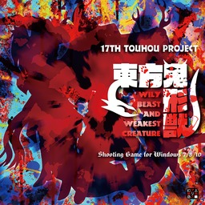

## Touhou 17 — 1.00b-r1 (first release)

A native Nintendo Switch port of Touhou 17: Wily Beast and Weakest Creature v1.00b, built on the TH17 C++ runtime from [eagler-touhou](https://github.com/Ritosa2333/eagler-touhou) and compiled natively for ARM64.

* 🐺 **The full game:** Reimu, Marisa and Youmu with the wolf, otter and eagle spirits, all 6 stages and Extra, endings, staff roll and replays.
* 🧊 **No freezes from heavy frames:** one game tick per screen refresh and no catch-up ticks, so spell captures and bullet-heavy frames can't snowball into a freeze.
* ⚡ **Faster stage changes:** the next stage is read and decompressed on another CPU core while you play, so the stage change frame is 38% shorter.
* 🎮 **Remappable controls** through Option → Key Config (defaults match the other ports: B shot, A bomb, L/ZL focus, R/ZR skip, + pause; the D-Pad and sticks only move).
* 🔊 BGM streamed straight from `thbgm.dat` with the original loop points.
* 👆 Touch controls in handheld mode.
* 📁 Recommended folder: `sd:/switch/touhou/touhou17/`, next to the other ports.

Put `touhou17.nro`, `th17.dat`, `thbgm.dat` and `msgothic.ttc` in the folder and launch from hbmenu. There is no long first launch: text is drawn straight from `msgothic.ttc`. If it runs out of memory from the album, start hbmenu by holding **R** while launching a game.
